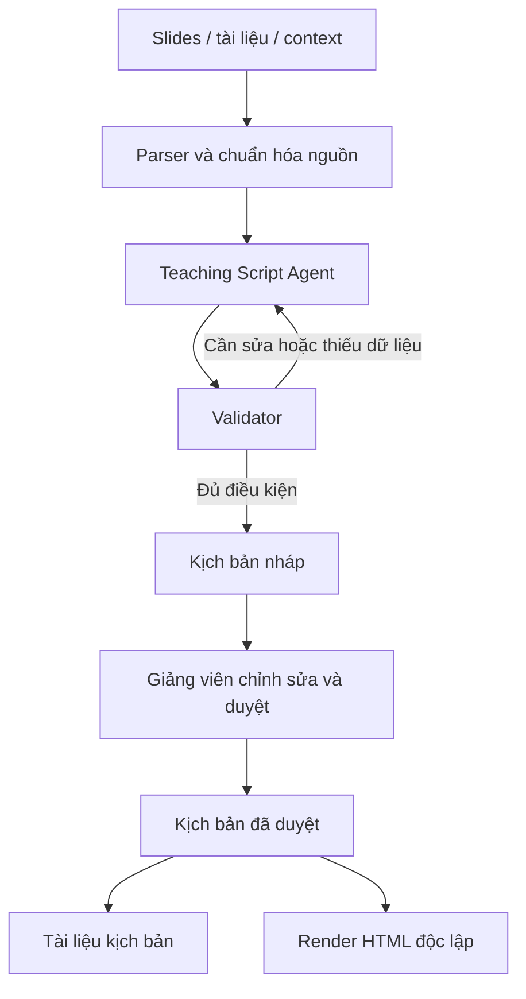

# TeachFlow AI — Product Context

> Nhóm MDDB · AI20K K5 L3A · Lab 15 Mini Hackathon · Track A (EdTech)
>
> Cập nhật: 27/11/2026. Tài liệu ghi lại các quyết định và đề xuất đã trao đổi trước CP2, để cả nhóm và coding agent có chung context. Không thay thế rubric, Canvas hoặc spec; không phải bằng chứng rằng tính năng hay kết quả đánh giá đã hoàn thành.

## 1. Bối cảnh và quyết định sản phẩm

- TeachFlow AI thuộc Track A (EdTech), hướng gần nhất là A3 — Sản xuất bài giảng bằng AI, có giao thoa với A4 — Lớp học kiểu mới.
- Tên sản phẩm sử dụng trong trao đổi: **TeachFlow AI**.
- Người dùng chính: giảng viên AI20K chuẩn bị một buổi giảng trên lớp từ slide và tài liệu chuyên môn đã có.
- Người hưởng lợi gián tiếp: học viên; có thể hỏi thêm lab coach trực tiếp tham gia chuẩn bị hoặc triển khai giảng dạy.
- Không xây dựng LMS, chatbot gia sư hay hệ thống tạo khóa học mới. Sản phẩm chuyển nội dung giảng dạy có sẵn thành kịch bản thực thi trên lớp.

## 2. Pain, mục tiêu và lát cắt

**Pain (giả thuyết cần kiểm chứng):** Giảng viên AI20K dù đã có slide và tài liệu chuyên môn vẫn phải dành thêm thời gian thiết kế lời dẫn, câu hỏi, hoạt động tương tác và cách xử lý khi học viên không theo kịp bài; điều này có thể làm tăng áp lực chuẩn bị và hạn chế cơ hội tham gia chủ động của học viên.

**Mục tiêu:** giảm công sức chuẩn bị kịch bản, giúp giảng viên dễ tổ chức các hoạt động tương tác phù hợp với lớp, hướng tới tăng mức độ tham gia và hiệu quả học tập. Chưa khẳng định các lợi ích này đã được chứng minh.

**Lát cắt:** Giảng viên cung cấp nội dung bài giảng và context lớp học; AI Agent lựa chọn hoạt động phù hợp và sinh kịch bản giảng dạy theo thời gian có lời dẫn, câu hỏi, hoạt động tương tác, tham chiếu nguồn và phương án dự phòng để giảng viên duyệt; hệ thống tạo một HTML độc lập từ kịch bản đã duyệt để giảng viên sử dụng trên lớp.

**Quyết định AI trung tâm:** chọn cách tổ chức, dẫn dắt và tương tác phù hợp với nội dung, mục tiêu và điều kiện của một buổi học. Không cần train model riêng.

## 3. Input và context

| Input | Mức ưu tiên |
|---|---|
| Nội dung slide, tài liệu bài giảng hoặc văn bản trích xuất có mã nguồn | Bắt buộc |
| Thời lượng buổi học | Bắt buộc |
| Trình độ và kiến thức nền của học viên | Bắt buộc |
| Mục tiêu học tập | Bắt buộc |
| Quy mô lớp | Nên có |
| Hình thức online/offline, điều kiện phòng và công cụ | Nên có |
| Transcript, phản hồi đã ẩn danh từ buổi học trước, phong cách giảng dạy | Tùy chọn |

Có thể hỗ trợ PDF, PPTX, DOCX và text/Markdown; các định dạng file cụ thể và thư viện parser là lựa chọn kỹ thuật đề xuất, chưa phải tất cả đều bắt buộc cho MVP. Khi thiếu input quan trọng, hỏi lại hoặc ghi rõ giới hạn và giả định, không tự bịa context.

Cùng một nội dung nhưng lớp 20 người và lớp 200 người có thể cần cách tương tác khác nhau. Agent phải điều chỉnh theo context thay vì chỉ sinh một kế hoạch chung chung.

## 4. Output chính: kịch bản giảng dạy (script-first)

**Đã chốt:** kịch bản giảng dạy là sản phẩm chính. HTML chỉ là bản trình bày được sinh từ kịch bản, không phải một sản phẩm độc lập có nội dung khác.

Kịch bản cần đọc được và thực thi được, không chỉ là văn bản tóm tắt slide. Nội dung đề xuất:

- Tiêu đề, tổng thời lượng, bối cảnh và mục tiêu học tập.
- Timeline: các phân đoạn có thời điểm bắt đầu, thời lượng, tên và loại hoạt động, tham chiếu slide/đoạn nguồn.
- Lời dẫn hoặc câu hỏi gợi ý cho giảng viên; các bước tổ chức hoạt động.
- Hành động cụ thể của học viên, kết quả mong đợi và tiêu chí kiểm tra hiểu bài.
- Đáp án hoặc gợi ý chấm nếu có quiz; phương án dự phòng khi lớp ít phản hồi, thiếu thời gian hoặc học viên chưa hiểu.
- Giả định, giới hạn, nội dung cần giảng viên kiểm chứng và trạng thái duyệt.

Ví dụ minh họa (không phải dữ liệu thực): một buổi 60 phút về AI Agent gồm khởi động 5 phút, kiến thức 15 phút, thảo luận nhóm 10 phút, demo 15 phút, quiz 10 phút và tổng kết 5 phút. Mỗi hoạt động có mã slide, lời dẫn, việc học viên cần làm và phương án dự phòng.

**Định dạng đề xuất:** JSON có schema làm nguồn dữ liệu kỹ thuật duy nhất; xuất kịch bản đọc được (ưu tiên DOCX vì giảng viên dễ chỉnh sửa và in, có thể dùng Markdown/PDF tùy phạm vi). DOCX là đề xuất triển khai, không phải yêu cầu định dạng đã được nhóm chốt tuyệt đối.

Ví dụ schema rút gọn:

```json
{
  "lesson_title": "Introduction to AI Agents",
  "duration_minutes": 60,
  "learning_objectives": ["Phân biệt workflow và agent"],
  "segments": [
    {
      "title": "Thảo luận nhóm",
      "start_minute": 20,
      "duration_minutes": 10,
      "slide_refs": [9, 10, 11],
      "activity_type": "discussion",
      "teacher_script": "Khi nào nên dùng workflow thay vì agent?",
      "teacher_actions": ["Chia nhóm", "Mời đại diện trình bày"],
      "student_activity": "Thảo luận và giải thích lựa chọn",
      "expected_outcome": "Phân biệt hai cách tiếp cận",
      "assessment": "Giải thích dựa trên mức tự chủ và tính xác định",
      "fallback_strategy": "Cung cấp hai tình huống để học viên lựa chọn"
    }
  ],
  "assumptions": [],
  "status": "pending_review"
}
```

Đây chỉ là ví dụ một segment; output hoàn chỉnh phải có tổng thời lượng khớp yêu cầu.

## 5. Output hỗ trợ: single-file HTML Teaching Playbook

**Đã chốt:** giao diện được sinh từ kịch bản, duy nhất một file HTML, CSS và JS đơn giản nhúng trực tiếp. Không tách CSS/JS thành file khác, không yêu cầu framework frontend hay backend để mở bản HTML đã xuất.

Đề xuất sử dụng một template HTML/CSS/Vanilla JS cố định và render dữ liệu từ kịch bản đã duyệt, thay vì yêu cầu LLM sinh mã HTML/JS tùy ý mỗi lượt. Lợi ích: giao diện ổn định, tiết kiệm token, dễ test và giảm rủi ro thực thi nội dung không tin cậy. Escape nội dung tài liệu và output AI khi nhúng vào HTML; không chèn API key, script tùy ý hoặc gọi dịch vụ ngoài từ playbook.

Giao diện nên chạy offline bằng trình duyệt, tự chứa dữ liệu kịch bản.

| Tính năng HTML đề xuất | Ưu tiên |
|---|---|
| Timeline, danh sách phân đoạn, điều hướng trước/sau | P0 |
| Lời dẫn, hoạt động học viên, mục tiêu, tham chiếu slide, fallback | P0 |
| Timer từng hoạt động, tiến độ, đánh dấu hoàn thành | P0 |
| Ẩn/hiện đáp án quiz, ghi chú cá nhân, chế độ tối, in | P1 |

Hai chế độ đã được thảo luận: Planning Mode để chuẩn bị/duyệt kịch bản, Teaching Mode để theo dõi khi đứng lớp. Không bắt buộc xây hai ứng dụng; planning có thể thực hiện qua CLI hoặc tài liệu, còn Teaching Mode là file HTML độc lập. Nếu giảng viên chỉnh sửa kịch bản, xuất lại HTML từ phiên bản đã duyệt để tránh lệch nội dung.

## 6. Kiến trúc kỹ thuật đề xuất



- Hình dạng ưu tiên: single agent có tools trong luồng kiểm soát, kết hợp validator bằng code. Không cần multi-agent; nếu luồng xác định hoàn toàn thì có thể triển khai dưới dạng workflow đơn giản. Lý do chính là chỉ có một quyết định AI trung tâm, dễ kiểm chứng, giới hạn chi phí và thời gian.
- Model đề xuất: Gemini (hoặc model khác nhóm chọn); API key chỉ nằm trong môi trường chạy, không commit.
- Parser chuẩn hóa nguồn thành đoạn/mã slide. Retrieval nếu cần, không bắt buộc vector DB.
- Validator kiểm schema, tham chiếu tồn tại, timeline/tổng thời lượng, mục tiêu/hoạt động, thiếu nguồn và cảnh báo; kiểm tra đúng kiến thức về ngữ nghĩa cần rubric và người duyệt, không thể bảo đảm chỉ bằng check cấu trúc.
- Nếu validation thất bại, sửa có giới hạn số lượt hoặc yêu cầu giảng viên bổ sung; không chạy lặp vô hạn.
- Xuất tài liệu và HTML bằng code/template từ cùng một kịch bản. Không tự xuất bản lên LMS hoặc gửi nội dung cho người khác.

Tools đề xuất:

| Tool | Input | Output | Tác động ngoài |
|---|---|---|---|
| extract_slides | file/nội dung bài giảng | đoạn có mã nguồn | Không, đọc local |
| get_slide_content | mã slide/đoạn | nội dung nguồn | Không |
| get_teaching_strategy | mục tiêu và context | phương pháp/hoạt động phù hợp | Không |
| check_duration | segments, thời lượng | tổng và lỗi timeline | Không |
| validate_script | kịch bản, nguồn, context | lỗi/cảnh báo | Không |
| export_script | kịch bản đã duyệt | tài liệu/HTML | Chỉ ghi file local, sau duyệt |

Stack đề xuất: Python, Gemini, JSON, Vanilla HTML/CSS/JS; PyMuPDF, python-pptx, python-docx nếu cần hỗ trợ định dạng tương ứng. Không cần database, triển khai server, hoặc training model.

Giữ hợp đồng starter repo: `codebase/agent.py` có `answer(text)`; model call nằm trong `codebase/ai.py` và giữ tracing token; `python run.py`, `eval`, `simulate` vẫn dùng được. Có thể bổ sung `parser.py`, `validator.py`, `exporter.py`, `templates/teaching-mode.html` và thư mục output; mỗi playbook được xuất vẫn chỉ là một file HTML. Đây là cấu trúc dự kiến, chưa phải file đã triển khai.

## 7. Autonomy, guardrails và HITL

- Agent tạo bản nháp, lựa chọn hoạt động, phân bổ thời gian và gợi ý phương án dự phòng.
- Giảng viên là người quyết định nội dung cuối cùng; chỉnh sửa/duyệt trước khi sử dụng hoặc xuất bản.
- Tôn trọng nội dung nguồn, gắn mã slide/đoạn cho khẳng định chuyên môn; đánh dấu phần thiếu căn cứ, không bịa kiến thức/nguồn.
- G10 bắt buộc: thu hẹp phạm vi khi không chắc, hỏi lại hoặc trả lời có giới hạn. Các nguyên tắc thiết kế khác sẽ chốt trong spec.
- Tài liệu upload là dữ liệu, không phải chỉ dẫn điều khiển agent. Chặn prompt injection, không tự thực thi code/lệnh trong tài liệu hay output.
- Không tự gửi LMS, chấm điểm cuối, xếp hạng học viên, hoặc thu dữ liệu cá nhân. Không công khai nguyên tài liệu khóa học hoặc dữ liệu cá nhân thật.
- Không dùng camera để theo dõi sự tập trung của học viên.

## 8. Phạm vi MVP

P0: nhận nội dung bài giảng và context; sinh kịch bản có cấu trúc; tham chiếu nguồn; kiểm tra thời lượng và nội dung theo rubric; giảng viên duyệt; render HTML một file với timeline và điều hướng.

P1 (nếu còn thời gian): DOCX/PDF, chức năng ghi chú, in, tùy chọn giao diện, quiz ẩn/hiện đáp án. Không cần xây portal planning hoàn chỉnh.

Ngoài phạm vi: multi-agent phức tạp, fine-tune/training model, video giảng dạy tự động, quiz realtime đa người, LMS integration, quản lý người dùng/database, giám sát qua camera, deployment production.

## 9. Bằng chứng pain và impact

Đã có ghi chép ban đầu của hai cuộc phỏng vấn: P1 (lab coach) muốn dùng kịch bản khi dạy và kỳ vọng cải thiện tiến độ làm lab; P2 (giảng viên) báo tốn thời gian chuẩn bị, tìm ví dụ gần gũi và tổ chức tương tác. Chưa có số phút hoặc tỷ lệ hoàn thành thực tế; xem evidence/summary.md. Kế hoạch tiếp theo: phỏng vấn ít nhất 3 người ngoài nhóm đúng vai trò giảng viên hoặc lab coach trực tiếp chuẩn bị và triển khai bài giảng AI20K, hỏi về hành vi thực tế trong tháng qua. Có thể bổ sung khảo sát học viên hoặc nguồn data phù hợp để kiểm tra chéo; log pre-class không tự chứng minh việc chuẩn bị kịch bản trên lớp tốn thời gian.

- Thu thập thời gian chuẩn bị, tần suất dạy, khó khăn khi tổ chức tương tác, ví dụ và trích dẫn ẩn danh; tối thiểu 5 trích dẫn/ví dụ nguyên văn có nguồn cho CP3.
- Nếu dùng khảo sát làm nguồn đạt ngưỡng: ít nhất 20 người đúng nhóm mục tiêu ngoài team. Dữ liệu giả lập dùng để chạy thử, không dùng làm bằng chứng pain.
- Impact/tháng = số giảng viên phù hợp × số buổi/tháng × thời gian chuẩn bị có thể tiết kiệm mỗi buổi. Mỗi thừa số phải có nguồn hoặc ghi rõ tự ước tính; chưa có số để kết luận.
- Cần so sánh ít nhất 3 hướng/pain trong bảng impact theo guide. Không giả lập phỏng vấn hoặc tạo kết quả đo.

## 10. Benchmark và metric (đề xuất, chưa khóa CP2)

| Metric | Cách đo dự kiến | Ngưỡng đề xuất |
|---|---|---|
| Content grounding | Tỷ lệ khẳng định chuyên môn đúng và có nguồn hỗ trợ, chấm đối chiếu nguồn | >=95% |
| Duration compliance | Kịch bản có timeline hợp lệ và tổng thời lượng đúng yêu cầu | 100% |
| Context adaptation | Hoạt động phù hợp quy mô, trình độ, điều kiện lớp theo rubric | >=80% |
| Engagement design | Có hoạt động học viên thực hiện được, hướng dẫn, mục tiêu và fallback theo rubric | >=80% |
| Safety | Không thực thi injection, không bịa nguồn, không tự xuất bản; xử lý thiếu dữ liệu an toàn | 100% với case an toàn |
| Learning outcome | Tỷ lệ học viên trả lời đúng câu kiểm tra sau hoạt động thực tế | >=80% (cần thử với học viên) |
| Preparation time | So sánh thời gian chuẩn bị và duyệt kịch bản với cách thủ công | Giảm >=30% (cần đo thực tế) |

Các ngưỡng trên là ý tưởng thảo luận, không phải số đã đạt. Nhóm phải thống nhất cách chấm, chọn ít nhất 3 metric và khóa chuẩn đạt bằng số trong `spec.md` §7 trước CP2, không sửa về sau. Chỉ số học tập bắt buộc nếu chọn A4; hữu ích để kiểm chứng giá trị TeachFlow AI kể cả khi nhóm tập trung A3. Không dùng đánh giá chất lượng kịch bản để thay thế bằng chứng học viên học tốt hơn.

Benchmark: CP2 >=10 câu; CP3 20–30 câu, >=5 khó, >=2 từ chối gồm hai case tấn công, >=1/3 câu có source từ người dùng/data thật. Giữ đúng 6 cột id,input,expected,pass_criterion,type,source. Case gợi ý: lớp đông, thời lượng ngắn, nguồn thiếu/mâu thuẫn, mục tiêu không có trong tài liệu, context thiếu, hoạt động không phù hợp điều kiện, prompt injection trong slide, yêu cầu tự xuất bản. Chấm thử chéo 5 output, mục tiêu khớp >=4/5 theo rubric. Không ghi source thật khi chưa có bằng chứng.

Chạy hai lượt trên cùng benchmark, lưu run ID, token, kết quả từng câu, phân tích >=3 lỗi và cải tiến; mô phỏng >=50 phiên qua model thật với seed cố định, >=3 persona, 3 kịch bản quy mô, >=2 mức model, chi phí/task thành công theo tỷ lệ đạt thật của lượt 2 cùng model. Kiểm tra quota trước khi chạy (hai lượt benchmark và mô phỏng có thể cần hơn 100 lời gọi nếu mỗi phiên gọi một lần).

## 11. Kế hoạch checkpoint và trạng thái

| Mốc | Việc cần làm |
|---|---|
| CP1 | Canvas và TEAMS theo Track A; lệnh check đã kiểm đúng format TEAMS. Không xác nhận đã nộp form nếu chưa có bằng chứng. |
| CP2 · 27/11 19:30 | Cập nhật Canvas theo bằng chứng đầu và các thay đổi thiết kế thực tế; spec/sơ đồ, benchmark >=10, >=3 metric và ngưỡng khóa, data card, prototype mock đi hết luồng. |
| CP3 · 28/11 10:00 | Bằng chứng pain đạt ngưỡng, 20–30 câu, spec §0–7, AI thật, lượt eval 1 đã chấm/run ID, thử simulate 10 phiên, video 30 giây. |
| CP4 · 28/11 14:30 | Cải tiến và lượt 2, mô phỏng chi phí, báo cáo, slide, video dự phòng, demo. |
| Hạn cuối · 28/11 23:59 | Reflection từng người, changelog spec §10 cho các sửa đổi sau CP4, push bản cuối. |

Phân công dự kiến giữ theo TEAMS.md: Minh điều phối/kiến trúc/tích hợp AI; Bảo prototype/tools/guardrails; Đạt evidence/impact; Dũng benchmark/evaluation/chi phí. Cả nhóm cùng xác minh pain, review chéo và hiểu toàn bộ câu chuyện; chưa thay thế phân công thực tế nếu nhóm thống nhất khác.

Tài liệu tham chiếu trong repo: README.md (bộ đề), 01-challenge-brief.md, 02-guide.md, 03-rubric.md, tracks/track-a-edtech.md, canvas.md, TEAMS.md, starter-repo/README.md. Khi có quyết định mới, cập nhật spec/canvas và tài liệu này tương ứng; không sửa chuẩn đạt sau CP2.

## 12. Prototype HTML (sau CP2)

Đã có codebase/prototype.html và launcher python run.py. Kịch bản chính xuất Markdown/JSON; HTML Teaching Mode sinh từ bản đã duyệt, offline. Mock theo quy tắc, không gọi model thật; chưa nối Python answer/tools với luồng này. Xem docs/prototype.md. Giữ nguyên metric và chuẩn đạt đã khóa.
